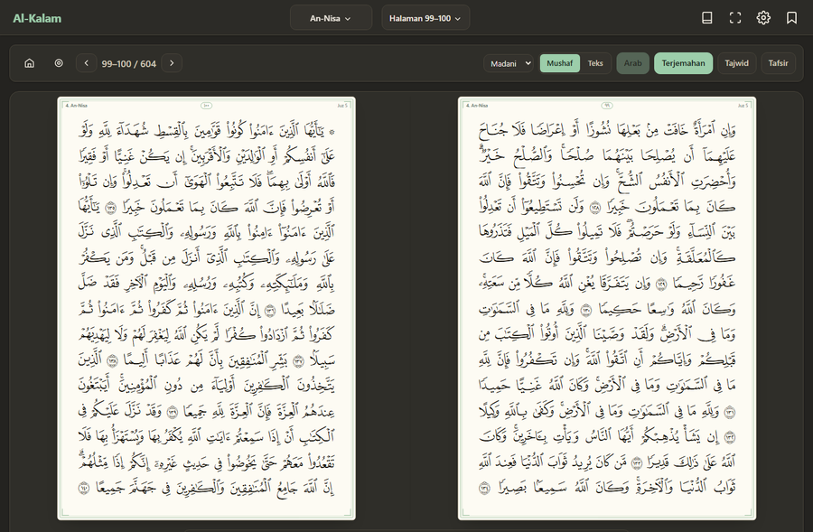
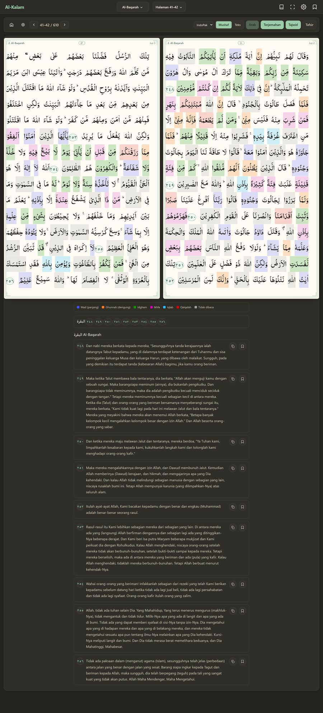
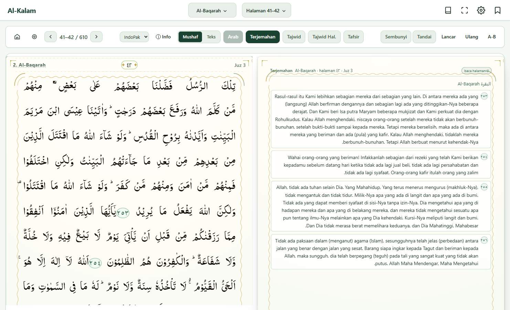
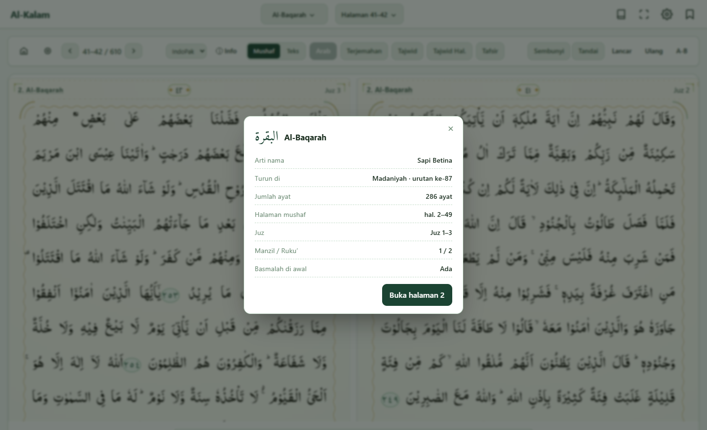
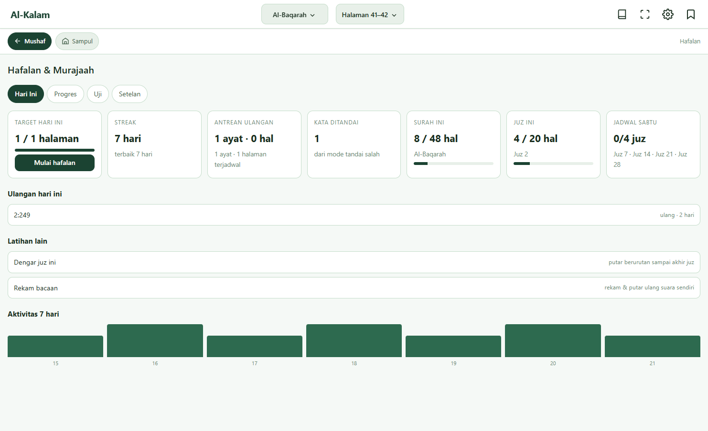
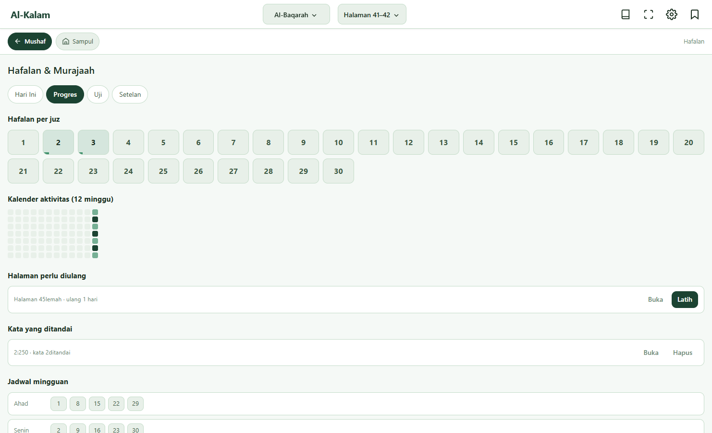
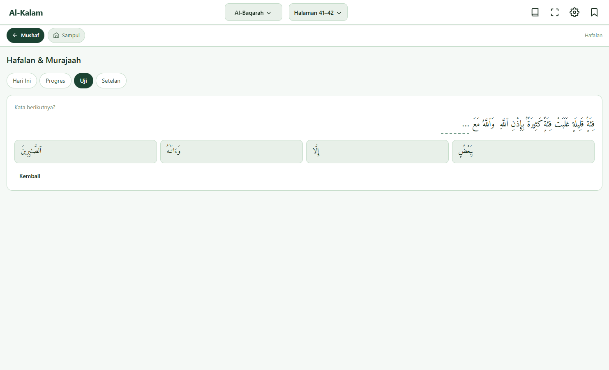
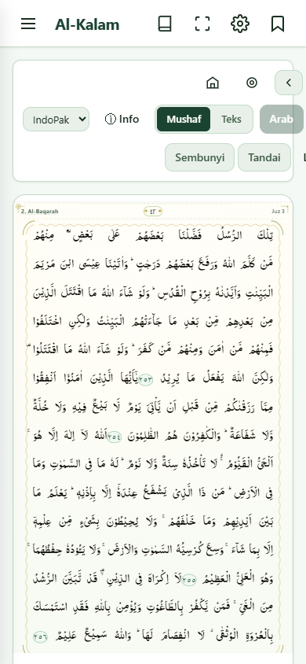

# Al-Kalam Digital — PWA Al-Qur'an Interaktif

Versi web ringan dari **Al-Kalam Digital v1.0** (Penerbit Diponegoro, 2009) yang aslinya berupa
aplikasi DVD Windows **2,8 GB**. Versi ini **≈16 MB** (kode + data), tanpa build tool, tanpa server:
semua data disimpan sebagai `.json.gz` dan dimuat sesuai kebutuhan.

**Demo:** https://chandraokta.github.io/al-kalam-pwa/

| | Aplikasi asli (2009) | Versi ini |
|---|---|---|
| Ukuran | 2,8 GB (26.408 file) | ±16 MB (61 berkas) |
| Instalasi | DVD + install | buka URL / "Install" (PWA) |
| Halaman mushaf | 604 JPEG 663×1005 + 604 SWF | layout + font QCF dirender di browser |
| Audio | 4 qari × 6.236 MP3 = 2,3 GB | 7 qari, streaming per surat (0 byte di repo) |
| Platform | Windows XP/Vista | HP, tablet, desktop, offline |

## Tangkapan layar

| Mushaf dua halaman (penuh) | IndoPak + tajwid |
|---|---|
|  |  |

| Terjemahan di lembar sebelah | Info surat |
|---|---|
|  |  |

| Hafalan — Hari Ini | Hafalan — Progres |
|---|---|
|  |  |

| Hafalan — Kuis | Ponsel (satu halaman) |
|---|---|
|  |  |

## Fitur

### Mushaf
- **Madani** (QCF v2, 604 halaman) dengan font per halaman, atau **IndoPak** 15 garis (610 hal.) dan 16 garis (548 hal.)
- Tampilan **satu halaman** (ponsel) atau **dua halaman** (layar lebar), halaman penuh — tiap lembar punya guliran sendiri
- Ayat yang diputar **menggulirkan lembarnya sendiri**; lembar lain tetap di bagian atas
- Bingkai lekuk (arabesque), ornamen pita surat, kepala halaman (surat · halaman · juz), tanda **۩ sajdah**, **۞ rubu'**, **hizb ½ juz**, **akhir juz**
- Baris yang berakhir pada ayat terakhir surat **dirata-tengah** (tidak direntangkan)

### Teks & warna
- Tajwid per huruf (IndoPak) dengan **palet lembut (hijau muda & kuning)** atau palet tegas; legenda adaptif + tooltip hukum
- Madani memakai **warna resmi font QCF**; tooltip per kata
- Mode Teks: ayat + terjemahan + tafsir, tombol serupa/copy/penanda

### Sumber teks
- **Terjemahan:** Indonesia, Kemenag, King Fahad, Saheeh, Pickthall, Urdu, Turki, **Transliterasi Latin**
- **Tafsir:** Indonesia ringkas/lengkap + **Muyassar (Arab)**
- **Info Surat** (klik nama surat): arti nama, Makkiyah/Madaniyah, urutan turun, jumlah ayat, halaman, juz, manzil/ruku
- **Info Kata** (tekan-lama / klik-kanan): arti, transliterasi, **morfologi** (jenis kata, akar, lemma)
- **Ayat serupa** (mutashabihat): indeks 689 ayat / 1.228 pasangan
- **Tema ayat** (topik QUL): tombol ◈ di tiap ayat + bagian “Tema di surat ini” di Info Surat; 2.930 topik, 4.095 ayat
- **7 qari** dengan timing kata per ayat (Alafasy, Abdul Basit, Husary, Sudais, Shatri, Minshawi, Shuraym)

### Hafalan & murajaah (menu **Hafalan**)
- **Hari Ini:** target harian, streak, antrean ulangan (ayat + halaman, SM-2), kata ditandai, kartu Surah & Juz, jadwal mingguan, pengingat
- **Progres:** grid 30 juz, heatmap 12 minggu, halaman lemah (tombol *Latih*), kata ditandai, jadwal 7 hari, ekspor/impor JSON
- **Uji:** lanjutkan ayat, lengkapi kata, cocokkan terjemahan, ayat serupa — cakupan halaman/surah/juz
- **Di mushaf:** Sembunyi (kata/ayat), Tandai (kata salah), Lancar/Ulang (halaman), A-B (ulangi audio), nomor ayat = penilaian ayat
- **Dengar juz**, **rekam bacaan** (MediaRecorder), **Tilawa (Beta)** — pengenal bacaan on-device

## Data

| Berkas | Ukuran | Isi |
|---|---|---|
| `layout.json.gz` | 370 KB | layout Madani 604 halaman |
| `layout-indopak.json.gz` | 590 KB | IndoPak 15 garis (610 hlm.) |
| `layout-indopak-16.json.gz` | 590 KB | IndoPak 16 garis (548 hlm.) |
| `layout-kfgqpc-v1.json.gz` | 371 KB | KFGQPC V1 1405H (604 hlm.) |
| `layout-kfgqpc-v4.json.gz` | 368 KB | KFGQPC V4 1441H (604 hlm.) |
| `chapters.json.gz` | 6 KB | 114 surat + info |
| `verses_by_chapter.json.gz` | 752 KB | 6.236 ayat + metadata (juz/hizb/rub/ruku/manzil/sajda) |
| `page_map.json.gz` | 34 KB | ayat per halaman |
| `juz_map.json.gz` | 15 KB | ayat per juz |
| `tajwid.json.gz` | 406 KB | markup tajwid per huruf |
| `words.json.gz` | 1.079 KB | 77.429 kata: arti + transliterasi |
| `morphology.json.gz` | 807 KB | akar, lemma, jenis kata |
| `similar.json.gz` | 5 KB | indeks ayat serupa |
| `topics.json.gz` | 123 KB | 2.930 topik/tema untuk 4.095 ayat |
| `translation_*.json.gz` | 2,3 MB | 8 terjemahan |
| `tafsir_*.json.gz` | 3,7 MB | 3 tafsir |
| `qul/*.json.gz` | 3,9 MB | timing kata 7 qari |

Font QCF (604 file) dan font IndoPak **tidak** disimpan di repo — diambil on-demand dari CDN QUL lalu di-cache service worker.

## Struktur

```
index.html          aplikasi satu halaman
css/style.css       seluruh tampilan
js/config.js        konfigurasi mushaf, qari, font
js/data.js          pemuat data (fetch + gzip + IndexedDB)
js/app.js           logika mushaf, teks, audio, tajwid
js/hifz.js          modul hafalan & murajaah
sw.js               service worker (offline + cache)
data/               data Qur'an (.json.gz)
tools/              skrip pengambil data & server lokal
docs/               tangkapan layar
```

## Menjalankan

```bash
python tools/serve.py 8080          # lalu buka http://127.0.0.1:8080
```

Deploy: branch `main` langsung dilayani **GitHub Pages** (folder akar, `.nojekyll`).
Versi aset memakai `?v=<build>` dan service worker melakukan revalidasi (`cache: no-cache`),
jadi pembaruan langsung terpakai setelah reload.

## Skrip data

| Skrip | Kegunaan |
|---|---|
| `fetch_layout.py` | layout Madani 604 halaman + font QCF |
| `fetch_layout_qul.py` | layout apa pun dari QUL (argumen: id + nama berkas) |
| `fetch_qul_segments.py` | timing kata per qari dari QUL |
| `fetch_more_text.py` | terjemahan tambahan (API quran.com) |
| `fetch_tafsir_cdn.py` | tafsir dari dataset terbuka spa5k/tafsir_api |
| `fetch_words.py` | arti & transliterasi per kata |
| `build_morphology.py` | morfologi dari Quranic Arabic Corpus |
| `build_similar.py` | indeks ayat serupa (shingle 3-kata + containment) |
| `fetch_topics.py` | topik/tema ayat dari halaman publik QUL
| `serve.py` | server lokal |

## Pengujian

Diuji dengan Chrome headless (CDP) pada 1400×1000 dan 390×844: mushaf satu/dua halaman,
tajwid, terjemahan, Info Surat, Info Kata, kuis hafalan, mode sembunyi, dan guliran per lembar.
Tilawa diuji memakai mikrofon palsu (`--use-file-for-fake-audio-capture`) dengan rekaman Al-Fatihah.

## Kredit & lisensi

Teks Qur'an, layout, font, dan timing audio dari **Quranic Universal Library** (TarteelAI, MIT)
dan **quran.com API**; tafsir dari [spa5k/tafsir_api](https://github.com/spa5k/tafsir_api);
morfologi dari **Quranic Arabic Corpus**; pengenal bacaan [Tilawa](https://github.com/yazinsai/tilawa) (MIT/CC BY 4.0).
