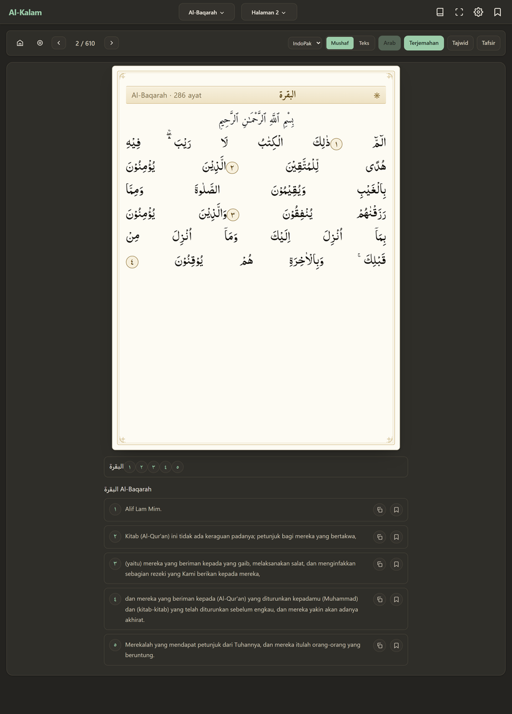
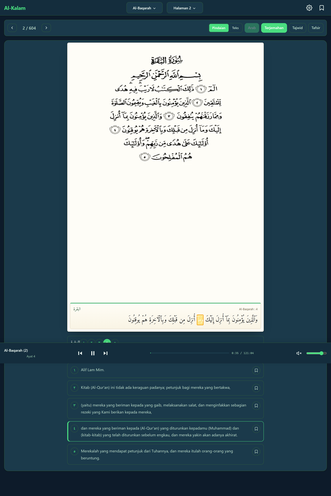
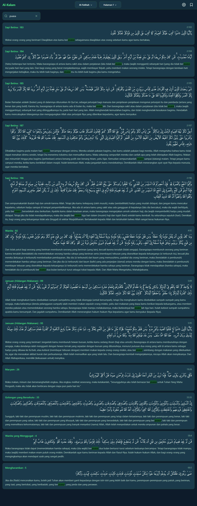
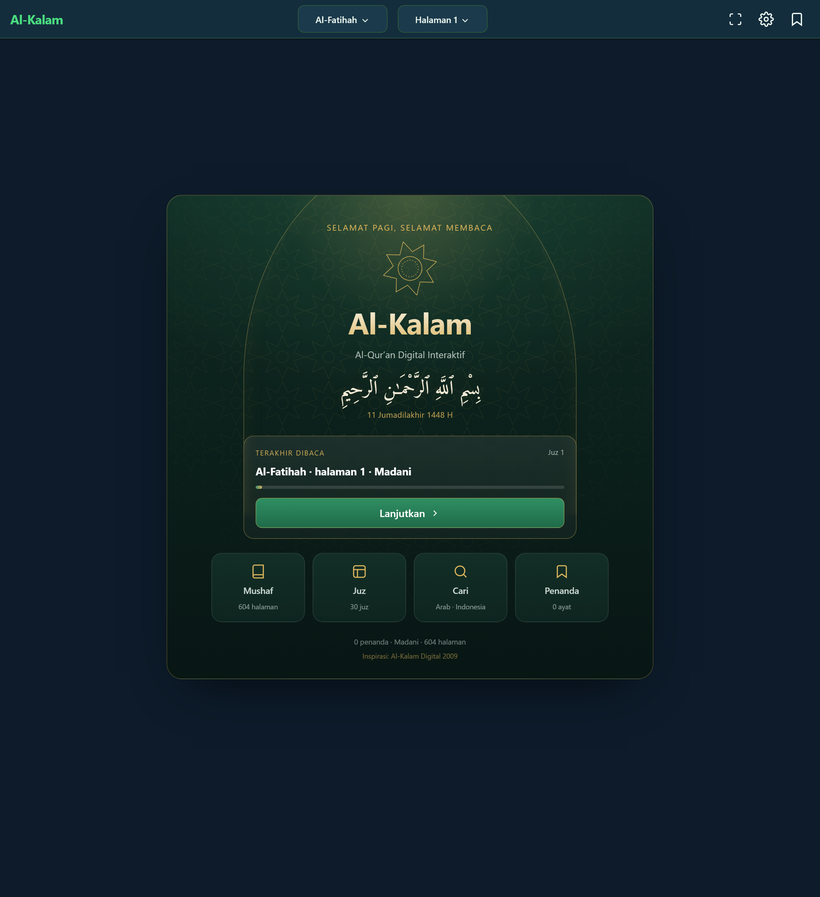
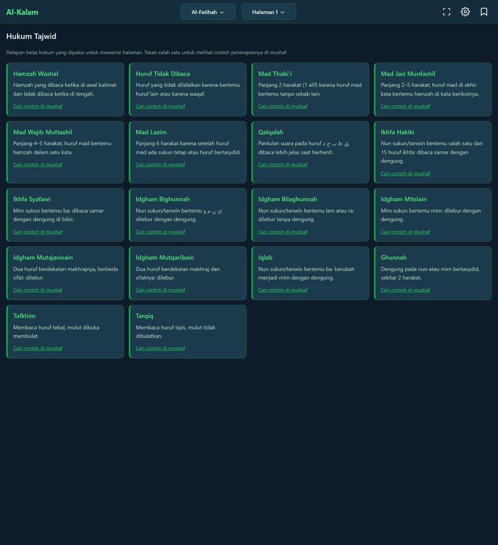
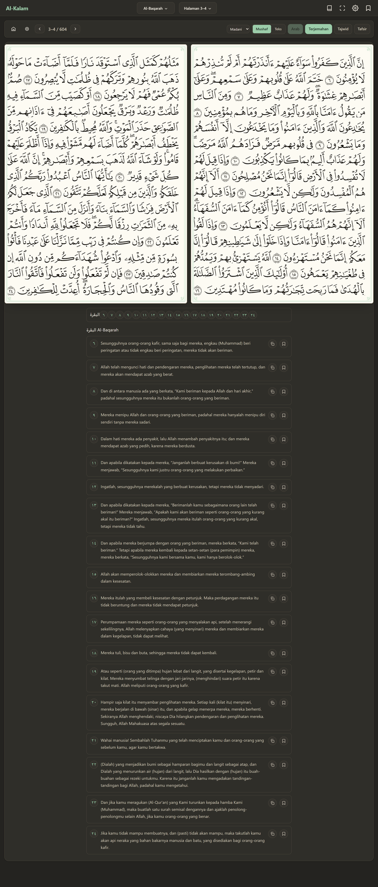
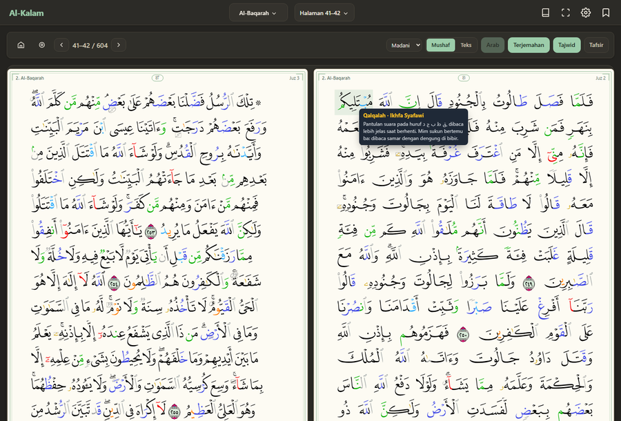
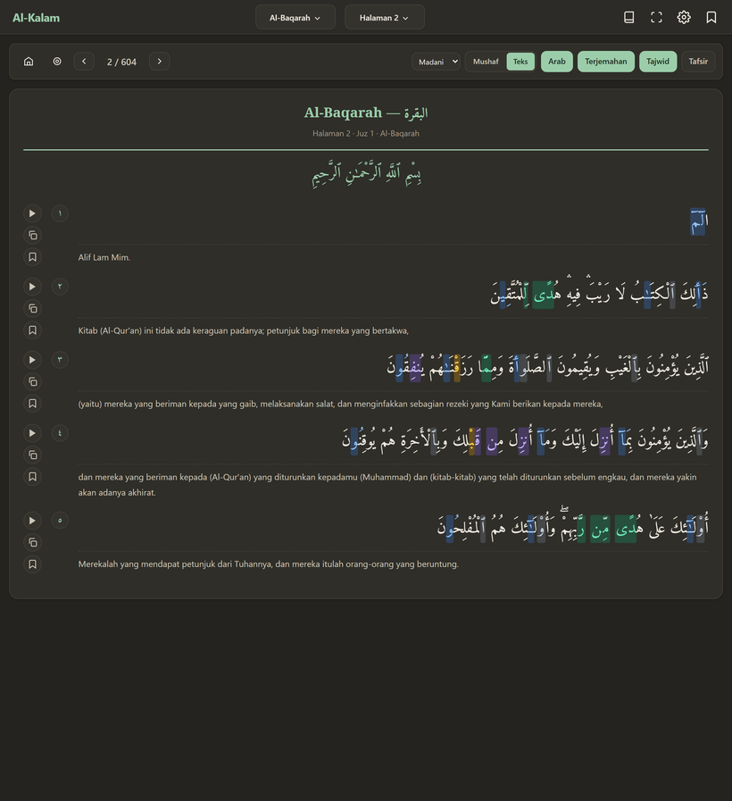

# Al-Kalam Digital — PWA Al-Qur'an Interaktif

Versi web ringan dari **Al-Kalam Digital v1.0** (Penerbit Diponegoro, 2009) yang aslinya
berupa aplikasi DVD Windows 2,8 GB. Aplikasi ini **10,4 MB** — halaman mushaf dirender di
browser dari data layout + font (Madani QCF per halaman, atau IndoPak nastaleeq).

| | Aplikasi asli (2009) | Versi ini |
|---|---|---|
| Ukuran | 2,8 GB (26.408 file) | **10,4 MB** (kode + data; font diambil saat dibuka) |
| Instalasi | DVD + install ke hardisk | buka URL / "Install" di browser |
| Halaman mushaf | 604 JPEG 663×1005 + 604 SWF | 604 halaman **render layout + font QCF** |
| Audio | 4 qari × 6.236 MP3 = 2,3 GB (lokal) | 4 qari, streaming **per surat** (0 byte di repo) |
| Platform | Windows XP/Vista | HP, tablet, desktop, offline (PWA) |

| Mushaf Madani (hal. 3) | Mushaf IndoPak (hal. 3) |
|---|---|
|  |  |

| Highlight mengikuti bacaan | Cari ayat |
|---|---|
|  |  |

| Sampul / beranda | Hukum Tajwid |
|---|---|
|  |  |

| Dua halaman (layar lebar) | Tajwid Madani (font berwarna) |
|---|---|
|  |  |

| Tajwid IndoPak (sorotan per kata) |
|---|
|  |

| Tema gelap (arang hangat + sage) |
|---|
|  |

| Mode teks + tajwid | Cari ayat |
|---|---|
|  |  |

---

## 1. Fitur

| Fitur | Keterangan |
|---|---|
| **Dua mushaf** | **Madani** (QCF 604 halaman) dan **IndoPak** (nastaleeq 610 halaman) — pilih di toolbar/pengaturan |
| **Mode teks** | teks Uthmani + warna tajwid, untuk belajar tajwid & menyalin ayat |
| Mushaf 604 halaman | navigasi halaman, tombol prev/next, lompat ke halaman mana pun |
| Murattal per ayat | klik ayat/nomor di bawah halaman atau tombol ▶; satu surat diputar utuh tanpa jeda |
| **Highlight mengikuti bacaan** | kata yang sedang dibaca disorot satu per satu — di mode pindaian tampil sebagai baris yang menempel di lembar halaman, di mode teks langsung pada ayat; halaman ikut berpindah sendiri |
| Pilih qari | Alafasy, Abdul Basit, Al-Husary, As-Sudais (streaming, bertiming kata) |
| Tajwid interaktif | 18 hukum tajwid diwarnai; **klik penanda** → nama + penjelasan |
| Terjemahan | Indonesia (Kemenag) & Inggris, bisa dimatikan |
| Tafsir | tafsir ringkas Indonesia per ayat |
| Index | per surat (114) dengan filter **Makkiyah/Madaniyah** + urutan turun, per juz (30), per halaman |
| Cari | Arab, Indonesia, Inggris — hasil bisa diklik langsung ke halaman |
| Penanda | simpan ayat (tersimpan di perangkat) |
| **Salin ayat** | tombol salin per ayat: Arab + terjemahan + rujukan `(2:255)` |
| **Hukum Tajwid** | halaman referensi 18 hukum + tombol cari contohnya di mushaf |
| **Sampul** | beranda dengan "Terakhir dibaca" dan pintasan Mushaf/Juz/Cari/Penanda |
| **Layar penuh** | Fullscreen API; bila ditolak browser, otomatis mode zen |
| **Tombol tengah** | lompat (gulir) ke ayat yang sedang dibaca |
| **Tafsir lengkap** | tombol "lengkap" pada tafsir ringkas (data 2,3 MB sudah tersedia) |
| Pengaturan | mushaf, mode halaman, ukuran font, tema (terang/**gelap arang-hangat**/sepia/auto), nomor ayat, qari, ulangi ayat |
| **Navigasi kembali** | bar kontekstual di tiap tampilan: tombol **Mushaf**, **Sampul**, dan **Kembali ke tampilan sebelumnya**; judul di header juga menuju sampul |
| Offline | halaman & data yang sudah dibuka tersimpan (service worker + IndexedDB) |
| Deep link | `?page=2&tajwid=1&tafsir=1` bisa dibagikan |

Pintasan papan tombol: `←`/`→` pindah halaman, `Space` putar/jeda, `↑`/`↓` volume,
`S` fokus pencarian, `Esc` tutup.

**Pemuatan pertama** (diukur di Chrome): 6 berkas data = **1,1 MB** — teks Qur'an 6236 ayat,
tajwid, terjemahan Indonesia, peta 604 halaman & 30 juz — ditambah **satu gambar halaman
(±120 KB)**. Halaman yang sudah dibuka memakai cache, jadi pindah halaman terasa instan.

---

## 2. Coba dulu (tanpa GitHub)

Karena menggunakan `fetch` untuk file data, aplikasi harus disajikan lewat HTTP
(tidak bisa dibuka dengan klik dua kali `index.html`).

```powershell
# dari folder ini
python -m http.server 8080
# lalu buka http://127.0.0.1:8080
```

Atau pakai `npx serve .`, `php -S localhost:8080`, dsb.

### Menjalankan dari VS Code

Aplikasi **tidak bisa** dibuka dengan klik dua kali `index.html` (protokol `file://`
ditolak browser untuk `fetch` dan `FontFace`). Harus lewat HTTP.

1. Buka folder `alkalam-pwa` di VS Code (`File → Open Folder`).
2. Tekan **`Ctrl+Shift+B`** — tugas *Al-Kalam: jalankan (port 8080)* langsung menyalakan
   server dan membuka browser ke `http://127.0.0.1:8080/index.html`.
   (Tugas ini ada di `.vscode/tasks.json`, memakai `python tools/serve.py`.)
3. Alternatif:
   - ekstensi **Live Server** → klik kanan `index.html` → *Open with Live Server*
     (port sudah disetel 8080 di `.vscode/settings.json`);
   - terminal: `python tools/serve.py` atau `npx serve .`;
   - debug dengan breakpoint: konfigurasi **Al-Kalam (Chrome)** di `.vscode/launch.json`
     (jalankan server dulu, lalu `F5`).

### Sepenuhnya offline (tanpa internet)

Secara bawaan font halaman diambil dari CDN QUL. Untuk lepas dari internet:

1. Unduh semua font sekali (Madani 604 font + IndoPak 1 font, ±93 MB):
   ```bash
   python tools/fetch_layout.py fonts
   ```
   atau lewat tugas VS Code **Al-Kalam: unduh font (mode offline)**.
2. Aktifkan mode offline, pilih salah satu:
   - ubah [`js/config.js`](js/config.js): `offline: true`,
   - atau buka `http://127.0.0.1:8080/index.html?offline=1` (tanpa mengubah berkas).

Dengan begitu `p1…p604.woff2` dan `indopak.woff2` dibaca dari `data/fonts/`.
Kalau ada halaman yang fontnya belum terunduh, aplikasi otomatis mencoba CDN
(jadi tetap jalan saat online).

> **Audio tetap butuh internet.** Murattal di-stream dari `audio-cdn.tarteel.ai`;
> untuk audio offline harus diunduh sendiri (satu qari ±1,7 GB) — lihat bagian 8.

Catatan: folder `data/fonts/` sengaja masuk `.gitignore` supaya repo tetap ±10 MB.

### Kalau tampilan masih versi lama

Service worker menyimpan bundel di perangkat. Sejak build `2026-11-20-qul-4`
strategi cache untuk HTML/JS/CSS adalah **network-first**, jadi satu kali muat ulang
sudah memakai kode terbaru. Kalau masih lama:

1. Lihat penanda versi di kaki menu (☰) — harus `build 2026-11-20-qul-4` atau lebih baru.
2. Buka **Pengaturan → Muat ulang aplikasi** (melepas service worker, menghapus cache,
   lalu memuat ulang dengan URL baru).
3. Atau tekan `Ctrl+Shift+R` sekali.

---

## 3. Pasang di GitHub (GitHub Pages)

```bash
cd alkalam-pwa
git init
git add .
git commit -m "Al-Kalam Digital PWA"
git branch -M main
git remote add origin https://github.com/USERNAME/alkalam-pwa.git
git push -u origin main
```

Lalu di repo: **Settings → Pages → Source: Deploy from a branch → Branch: `main` / `/ (root)`**.
Situs tersedia di `https://USERNAME.github.io/alkalam-pwa/` dalam 1–2 menit.

Semua path di aplikasi relatif (`./data/`, `./js/`), jadi bisa ditaruh di subfolder
mana pun. File `.nojekyll` disertakan agar GitHub Pages tidak memproses folder
dengan awalan garis bawah.

> **Ukuran repo:** 10,4 MB total —
> masih jauh di bawah batas GitHub (1 GB per repo, 100 MB per file).
> Audio **tidak** disimpan di repo (lihat bagian 5).

---

## 4. Halaman mushaf: layout + font halaman

Halaman tidak lagi berupa gambar. `data/layout.json.gz` (370 KB) menyimpan struktur
mushaf 604 halaman:

```
{ "pages": { "2": { "lines": [ [],
                            [],
                            [["2:1",1,"﵂",0], ["2:1",2,"﵃",0], …],
                            … ] } },
  "surahs": { "2": {"page":2,"name":"البقرة","name_simple":"Al-Baqarah","ayahs":286,"bismillah":true}, … } }
```

Tiap entri = `[surat:ayat, urutan kata, kode glyph, penanda_akhir_ayat]`.
Baris kosong di data dipakai sebagai tempat **pita judul surat** dan **basmalah**.

Font halaman QCF (`p1 … p604`) diambil sesuai halaman yang dibuka:

```
https://static-cdn.tarteel.ai/qul/fonts/quran_fonts/v2/woff2/p{1..604}.woff2
```

(dimuat lewat `FontFace`, CORS terbuka, lalu ditambahi ke `document.fonts`).
Halaman tetangga ikut dipanaskan lebih dulu, jadi pindah halaman terasa instan.

Kalau ingin font disimpan lokal (offline penuh), unduh sekali lalu ubah config:

```bash
python tools/fetch_layout.py fonts      # 604 font ke data/fonts/
```

```js
// js/config.js
fontsLocal: './data/fonts/',            // pakai berkas lokal
```

Konsekuensi penting: karena setiap kata adalah elemen sendiri (`.mw`),
highlight bisa menyala **tepat di atas kata pada halaman** — bukan lagi strip terpisah.

---

## 5. Dua mushaf: Madani & IndoPak

Pemilih **Madani / IndoPak** ada di toolbar dan di Pengaturan. Keduanya memakai mesin
render yang sama; yang berbeda hanya data layout dan font.

| | Madani | IndoPak |
|---|---|---|
| Layout | `data/layout.json.gz` (370 KB) | `data/layout-indopak.json.gz` (590 KB) |
| Halaman | 604 | **610** |
| Font | QCF **per halaman** (`p1`…`p604`, diambil per halaman) | **satu** font nastaleeq (77 KB) |
| Sumber layout | quran.com API (`line_number`, `code_v2`) | QUL — Indopak 15 lines (Qudratullah) |
| Sumber font | `…/quran_fonts/v2/woff2/p{n}.woff2` | `…/nastaleeq/Hanafi/normal-v4.2.2/with-waqf-lazmi/font.woff2` |

Layout IndoPak diambil per halaman dari halaman pratinjau QUL
(`/resources/mushaf_layout/12?page=N`) lalu dirapikan menjadi:

```json
{ "pages": { "3": [ {"kind":"words","words":[["2:6",1,"اِنَّ",0], …]}, … ] },
  "surahs": { "2": {"page":2}, … } }
```

Baris bertipe `surah` dan `bismillah` datang langsung dari sana, jadi tidak perlu
menebak seperti pada layout Madani. Penanda akhir ayat IndoPak memakai glyph QCF,
karena itu diganti lencana angka (`span.mw-end-badge`) supaya tidak jadi kotak.

Bangun ulang:

```bash
python tools/fetch_indopak.py     # ±2 menit, 610 halaman
```

---

## 6. Highlight mengikuti bacaan (QUL)

Data dibangun dari **[Quranic Universal Library](https://github.com/TarteelAI/quranic-universal-library)**
(TarteelAI, lisensi MIT) lewat API publiknya:

```
GET https://qul.tarteel.ai/api/v1/audio/surah_segments/{recitation_id}?chapter={1..114}&per_page=286
```

Isi tiap ayat: `time_from` / `time_to` (ms absolut di dalam file surat) dan
`segments: [[kata_ke, mulai_ms, selesai_ms], …]` — nomor kata dimulai dari 1.

Hasil build: `data/qul/<qari>.json.gz` (4 berkas, 2,2 MB):

```
{ "recitation": 7,
  "audio":  { "1": {"u": ".../001.mp3", "d": 46}, … },           // mp3 satu surat penuh
  "verses": { "1:1": {"f": 0, "t": 5896, "s": [[1,0,591], …]}, … } }
```

Kenapa per surat, bukan per ayat? Karena QUL menyediakan **satu MP3 per surat** beserta
timing seluruh ayat di dalamnya. Keuntungannya:

- bacaan **mengalir tanpa jeda** antar ayat (tidak ada ganti berkas, tidak ada latensi),
- highlight memakai waktu absolut berkas — tidak mungkin melenceng,
- 114 permintaan audio, bukan 6.236; CDN-nya melayani potongan lewat HTTP Range.

Saat diputar, aplikasi mencari ayat yang memuat waktu sekarang (`ayahAt`), memperbarui
ayat yang disorot, memindahkan halaman mushaf bila perlu, lalu menyorot kata
(`span.w.on`) sesuai segmen. Qari yang tersedia — semuanya bertiming lengkap 6.236 ayat:
**Alafasy (7), Abdul Basit Murattal (2), Al-Husary (6), As-Sudais (3)**.

Bangun ulang data timing:

```bash
python tools/fetch_qul_segments.py             # semua qari
python tools/fetch_qul_segments.py alafasy     # satu qari saja
```

---

## 7. Menaruh data di repo GitHub terpisah


Kalau data ingin dipisah dari aplikasi (mis. repo `alkalam-data`), ubah
[`js/config.js`](js/config.js):

```js
window.ALKALAM_CONFIG = {
  // jsDelivr (disarankan: ada CDN + cache)
  dataBase: 'https://cdn.jsdelivr.net/gh/USERNAME/alkalam-data@main/data/',
  pagesBase: 'https://cdn.jsdelivr.net/gh/USERNAME/alkalam-data@main/data/pages/',
  audioBase: 'https://everyayah.com/data/',
  ...
};
```

Tidak perlu mengubah kode lain. Isi folder `data/` cukup diunggah ke repo tersebut.

---

## 8. Audio: kenapa tidak masuk repo

2,3 GB audio adalah 82% ukuran aplikasi asli. Di versi ini audio **di-stream**
dari CDN QUL (`audio-cdn.tarteel.ai`) — satu MP3 per surat:

```
https://audio-cdn.tarteel.ai/quran/surah/alafasy/murattal/mp3/001.mp3
```

Hasilnya: aplikasi tetap ±6 MB, dan CDN hanya mengirim bagian berkas yang sedang diputar (HTTP Range).

Kalau ingin audio ikut di repo sendiri (mis. untuk pemakaian offline penuh),
unduh satu qari lalu arahkan `audioBase` ke folder tersebut:

```python
# contoh: unduh 1 qari utuh (per surat, ≈1,7 GB) ke ./audio/alafasy/
import pathlib, urllib.request
base = "https://audio-cdn.tarteel.ai/quran/surah/alafasy/murattal/mp3"
out = pathlib.Path("audio/alafasy"); out.mkdir(parents=True, exist_ok=True)
for ch in range(1, 115):
    f = out / f"{ch:03d}.mp3"
    if not f.exists():
        urllib.request.urlretrieve(f"{base}/{ch:03d}.mp3", f)
```

Lalu di [`js/config.js`](js/config.js) set `audioBase` qari itu ke `./audio/alafasy/`
dan `dataBase`/`pagesBase` tetap. Data timing kata (`data/qul/*.json.gz`) tidak berubah
karena waktu dihitung relatif terhadap berkasnya.


---

## 9. Membangun ulang data

Skrip ada di [`tools/`](tools) (Python 3, hanya pustaka standar):

| Skrip | Fungsi |
|---|---|
| `fetch_all.py` | teks Uthmani + tajwid + peta halaman/juz → `data/*.json.gz` |
| `fetch_indo_translation.py` | terjemahan Indonesia 6.236 ayat |
| `fix_translation_keys.py`, `fix_translation_keys2.py` | memetakan ulang nomor ayat global → `surat:ayat` |
| `fetch_qul_segments.py` | timing kata + audio per surat dari QUL |
| `fetch_tafsir.py` | tafsir ringkas & lengkap Indonesia |
| `fix_tafsir_keys.py` | perbaikan kunci tafsir |

```bash
python tools/fetch_all.py
python tools/fetch_indo_translation.py
python tools/fix_translation_keys2.py
python tools/fetch_tafsir.py
python tools/fix_tafsir_keys.py
```

Hasil akhir: 10 file `.json.gz` (±4,9 MB) di `data/`. Aplikasi men-dekompresi
dengan `DecompressionStream` bawaan browser — tanpa pustaka pihak ketiga.

---

## 10. Sumber data & lisensi

| Data | Sumber | Catatan |
|---|---|---|
| Teks Uthmani, tajwid, peta halaman/juz | [quran.com API](https://api.qurancdn.com) (`/api/qdc`) | teks Qur'an: bebas digunakan, mohon jaga kesucian teks |
| Terjemahan & tafsir Indonesia | [api.quran.gading.dev](https://api.quran.gading.dev) | terjemahan Kemenag RI & tafsir ringkas |
| Terjemahan Inggris | berkas terjemahan DVD Al-Kalam (2009) | hanya dipakai sebagai cadangan |
| Audio per surat | QUL / TarteelAI (`audio-cdn.tarteel.ai`) | rekaman murattal |
| Gambar halaman mushaf | [Miftah-Fentaw/Quran-Images](https://github.com/Miftah-Fentaw/Quran-Images) | **MIT**; tinta 1080×1440 → rekode 900×1200 di latar kertas |
| Timing kata (word-by-word) | quran.com API (udio.segments) | dipakai untuk highlight per kata |
| Font Arab | [Amiri](https://github.com/aliftype/amiri) (SIL OFL 1.1) | di-host lokal di `assets/fonts/` |

**Catatan hak cipta:** aplikasi asli Al-Kalam Digital (Penerbit Diponegoro) beserta
isi DVD-nya (halaman, tafsir, audio) **tidak** disalin ke proyek ini. Versi web ini
dibangun ulang dari data Qur'an terbuka, dengan tata cara pemakaian yang meniru
aplikasi aslinya (klik ayat untuk memutar, tajwid berwarna, dsb). Kode aplikasi
ini bebas Anda pakai dan ubah.

---

## 11. Struktur berkas

```
alkalam-pwa/
├── index.html              # shell aplikasi (semua view + modal)
├── manifest.json           # metadata PWA
├── sw.js                   # service worker: app shell + data + halaman offline
├── .nojekyll               # agar GitHub Pages tidak memproses folder _*
├── js/
│   ├── config.js           # lokasi data/audio + daftar qari
│   ├── data.js             # pemuat data (gzip + IndexedDB cache)
│   └── app.js              # UI, mushaf, audio, cari, penanda, pengaturan
├── css/style.css           # tema terang/gelap/sepia, responsif, cetak
├── assets/
│   ├── fonts/              # Amiri woff2 (Arab, 400 & 700)
│   └── icons/              # ikon PWA 72–512 px
├── data/                   # 10 file .json.gz (teks, tajwid, terjemahan, tafsir, peta)
│   ├── qul/                # timing kata per qari dari QUL
│   ├── layout.json.gz      # layout mushaf Madani (604 halaman)
│   └── layout-indopak.json.gz  # layout mushaf IndoPak (610 halaman)
├── .vscode/                # tugas & konfigurasi VS Code (Ctrl+Shift+B)
├── tools/                  # skrip Python pembangun data + serve.py
└── _test/                  # harness uji browser (tidak diperlukan saat deploy)
```

---

## 12. Yang belum ada (beda dari aplikasi asli)

| Fitur asli | Status di versi ini |
|---|---|
| Tampilan halaman mushaf hasil pindai (604 JPEG) | **ada** — 604 gambar 900×1200 di `data/pages/` (mode Pindaian) |
| Overlay tajwid di dalam halaman Flash | diganti mode Teks: warna tajwid + penjelasan saat diklik |
| Peta interaktif halaman (Flash `SWF`/`.ocp`) | tidak relevan di web; gambar halaman + strip nomor ayat menggantikannya |
| Index tema (TAUHID, dll. dari `03/02/*.dtp`) | belum; bisa ditambah dengan menaruh `data/topics.json` |
| Menu "keluar" | tidak perlu di PWA (tutup tab / app) |
